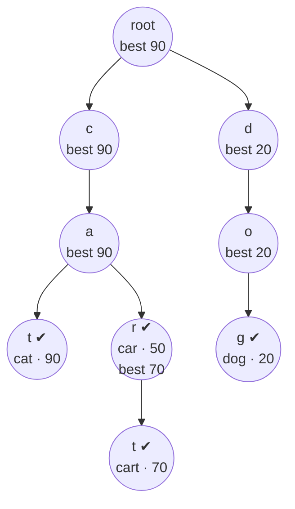

<div align="center">


<br/>

[](https://github.com/YOUR_USERNAME/tinycomplete/actions)
[](https://www.python.org/)
[](pyproject.toml)
[](LICENSE)
[](https://github.com/YOUR_USERNAME/tinycomplete/stargazers)

### ⚡ Type two letters. Get the best five answers. Instantly.

**A tiny, readable, zero-dependency autocomplete engine built from two classic data structures: a Trie and a Heap.**

[✨ Features](#-features) •
[🚀 Quick start](#-quick-start) •
[🧠 How it works](#-how-it-works) •
[📖 API](#-api) •
[📊 Benchmarks](#-benchmarks) •
[🗺️ Roadmap](#%EF%B8%8F-roadmap) •
[🤝 Contributing](#-contributing)

</div>

---

## ✨ Features

| | Feature | Details |
|:--:|---|---|
| 🌳 | **Trie-powered** | Finding a prefix costs `O(len(prefix))`, never the size of your dataset |
| 🏆 | **Ranked results** | Every word has a weight; you always get the *best* `k`, not just any `k` |
| 🧭 | **Early stopping** | Best-first search stops after `k` results instead of scanning every match |
| 📈 | **Learns from users** | `bump()` raises a word's rank each time someone picks it |
| 🗑️ | **Full CRUD** | `add`, `bump`, `remove` (with branch pruning), `weight` |
| 💾 | **Save and load** | One-line JSON persistence |
| 🖥️ | **CLI included** | Interactive prompt: `python -m tinycomplete words.txt` |
| 🪶 | **Tiny** | About 200 lines, pure standard library, **0 dependencies** |
| ✅ | **Tested** | Unit tests plus a randomized test checked against brute force |

---

## 🚀 Quick start

```bash
git clone https://github.com/YOUR_USERNAME/tinycomplete.git
cd tinycomplete
pip install -e .
```

```python
from tinycomplete import Autocomplete

ac = Autocomplete.from_words([
    ("python", 95), ("pytorch", 88), ("pytest", 40),
    ("pandas", 77), ("postgres", 74),
])

ac.suggest("py")            # ['python', 'pytorch', 'pytest']
ac.suggest("p", k=2)        # ['python', 'pytorch']

ac.bump("pytest", 100)      # a user picked it, so it rises in the ranking
ac.suggest("py", k=1)       # ['pytest']
```

### 🖥️ Try the CLI

```console
$ python -m tinycomplete examples/words.txt ja -k 3
javascript	90
java	80
```

Leave out the prefix for an interactive prompt:

```console
$ python -m tinycomplete examples/words.txt
Loaded 25 entries. Type a prefix (empty line to quit).
> py
  python  (95)
  pytorch  (88)
  pytest  (40)
```

---

## 🧠 How it works

> **Plain-English version:** a phone book groups names by their first letters. A *trie* does that for every letter of every word, so jumping to "everything starting with `py`" is instant. A *heap* then hands us the best-ranked branch first, so we stop early.

### 1. The Trie stores words by shared prefixes

Words `cat (90)`, `car (50)`, `cart (70)`, `dog (20)`. Each node remembers `best`, the highest weight anywhere below it:



### 2. The Heap explores the most promising branch first

For `suggest("ca", k=2)`:

1. Walk `c → a` (2 steps, regardless of dataset size).
2. Push the `ca` node into a max-priority queue, ranked by its `best`.
3. Pop the top item. If it's a **word**, output it. If it's a **branch**, expand its children back into the heap.
4. Repeat until `k` words are out. Everything else is **never visited**.

Because `best` is an upper bound for everything below a node, the first `k` words popped are guaranteed to be the true top `k`.

### Complexity

| Operation | Time | Notes |
|---|---|---|
| `add` / `weight` / `in` | `O(L)` | `L` = word length |
| `bump` | `O(L)` | |
| `remove` | `O(L · σ)` | `σ` = branching factor, recomputes `best` on the path |
| `suggest(prefix, k)` | `O(L + k · L · log b)` | independent of how many total matches exist (`b` = branches in the heap) |
| Space | `O(total characters)` | shared prefixes are stored once |

---

## 📖 API

| Method | What it does |
|---|---|
| `Autocomplete(case_sensitive=False)` | Create an empty engine |
| `Autocomplete.from_words(items)` | Build from words or `(word, weight)` pairs |
| `.add(word, weight=1)` | Insert, or overwrite the weight |
| `.bump(word, by=1)` | Increase a word's weight (learning from clicks) |
| `.remove(word) -> bool` | Delete and prune empty branches |
| `.suggest(prefix, k=5) -> list[str]` | Top-`k` completions, best first, ties alphabetical |
| `.suggest_with_scores(prefix, k=5)` | Same, as `(word, weight)` tuples |
| `.weight(word)` | Current weight, or `0` if absent |
| `.items()` | Iterate all `(word, weight)` |
| `.save(path)` / `Autocomplete.load(path)` | JSON persistence |
| `len(ac)`, `word in ac` | Size and membership |

> Words are lowercased by default and suggestions come back lowercased. Use `case_sensitive=True` to keep the original case.

---

## 📊 Benchmarks

`tinycomplete` against the naive approach (scan every word, filter by prefix, rank the matches). Dataset: **187,523 random words** with random weights, top-5 results, CPython 3.12.

| Prefix | Naive | tinycomplete | Speed-up |
|:--:|--:|--:|--:|
| `a` | 12.48 ms | 0.056 ms | **~220×** |
| `ab` | 11.12 ms | 0.025 ms | **~450×** |
| `abc` | 10.86 ms | 0.014 ms | **~770×** |

Numbers vary by machine. Run it yourself:

```bash
python benchmarks/bench.py
```

The script also asserts that both methods return identical results.

---

## 🗂️ Project structure

```text
tinycomplete/
├── 📁 tinycomplete/
│   ├── __init__.py
│   ├── engine.py        # the Trie + Heap engine
│   └── __main__.py      # command-line interface
├── 📁 tests/            # unit + randomized brute-force tests
├── 📁 examples/         # demo.py, words.txt
├── 📁 benchmarks/       # bench.py
├── 📁 assets/           # logo and banner (SVG)
├── 📁 .github/workflows # CI on Python 3.9 – 3.12
├── pyproject.toml
├── LICENSE
└── README.md
```

Run the tests:

```bash
pip install -e ".[dev]"
pytest -q
```

---

## 🗺️ Roadmap

- [x] Ranked top-`k` suggestions
- [x] Learning with `bump()`
- [x] Remove with pruning
- [x] JSON save and load
- [ ] Fuzzy matching (typo tolerance with edit distance)
- [ ] Unicode normalization options
- [ ] Time-decay weights (recent picks count more)
- [ ] Publish to PyPI

Have an idea? [Open an issue](https://github.com/YOUR_USERNAME/tinycomplete/issues).

---

## 🤝 Contributing

Contributions are welcome and beginner-friendly.

1. Fork the repo and create a branch: `git checkout -b feature/my-idea`
2. Add tests for your change and run `pytest`
3. Commit with a clear message and open a pull request

---

## 📜 License

Released under the [MIT License](LICENSE).

<div align="center">

<br/>

**If this helped you learn tries and heaps, please give it a ⭐. It really helps!**

<sub>Built with 💜 as part of a journey to master Data Structures and Algorithms.</sub>

</div>
